# Microsoft Defender for Servers tools

This repository contains Azure Policy and Azure Machine Configuration solutions for managing Microsoft Defender for Endpoint settings across Azure and Azure Arc-enabled servers.

## Table of contents

- [Solutions](#solutions)
  - [Defender for Endpoint passive mode](#defender-for-endpoint-passive-mode)
  - [Defender for Endpoint device tagging](#defender-for-endpoint-device-tagging)
  - [Arc to Entra security group synchronization](#arc-to-entra-security-group-synchronization)
- [Choose a solution](#choose-a-solution)
- [Deployment guidance](#deployment-guidance)
- [Repository structure](#repository-structure)

## Solutions

### Defender for Endpoint passive mode

The passive-mode solution audits and configures whether Microsoft Defender Antivirus runs in active or passive mode on Windows machines. It manages the `ForceDefenderPassiveMode` registry value through Azure Machine Configuration.

The complete solution can also deploy Change Tracking and Inventory, an Azure Monitor Data Collection Rule, and an Azure Monitor workbook. Together, these components provide current compliance status and historical visibility into mode changes.

Supported targets include Windows Azure virtual machines, virtual machine scale sets, and Azure Arc-enabled servers.

[View the passive-mode solution guide](PASSIVE-MODE-SOLUTION.md)

### Defender for Endpoint device tagging

The device-tagging solution audits and configures Microsoft Defender for Endpoint `Group` device tags on Windows and Linux machines through separate platform-specific Machine Configuration packages and Azure Policy definitions.

- **Windows:** Manages the `Group` `REG_SZ` value under the Microsoft Defender for Endpoint `DeviceTagging` registry key.
- **Linux:** Manages the `GROUP` tag in `/etc/opt/microsoft/mdatp/managed/mdatp_managed.json`, with merge and overwrite modes.

Supported targets include applicable Azure virtual machines, virtual machine scale sets, Azure Arc-enabled servers, and Azure Arc-enabled VMware vSphere virtual machines.

[View the device-tagging solution guide](machineConfiguration/DEVICE-TAGGING-SOLUTION.md)

### Arc to Entra security group synchronization

The PowerShell Azure Functions solution correlates Arc-enabled Windows and Linux servers through Defender for Endpoint to existing Entra device objects. Scheduled reconciliation and Arc resource-write events drive optional, verified security-group additions. A separate Entra-authenticated HTML dashboard shows correlation, observed membership, and persisted history.

It starts in audit-only mode. Machines without an Entra device are reported without membership changes, and the solution never removes members.

[View the Arc to Entra synchronization guide](entragroup-sync/README.md)

## Choose a solution

| Requirement | Solution |
| --- | --- |
| Configure Microsoft Defender Antivirus active or passive mode on Windows | [Passive mode](PASSIVE-MODE-SOLUTION.md) |
| Monitor historical changes to the passive-mode registry setting | [Passive mode](PASSIVE-MODE-SOLUTION.md) |
| Configure Microsoft Defender for Endpoint device groups on Windows | [Device tagging](machineConfiguration/DEVICE-TAGGING-SOLUTION.md) |
| Configure Microsoft Defender for Endpoint device groups on Linux | [Device tagging](machineConfiguration/DEVICE-TAGGING-SOLUTION.md) |
| Correlate Arc/MDE machines to Entra devices and add verified devices to a security group | [Arc to Entra sync](entragroup-sync/README.md) |
| Filter policy applicability by Azure resource tags | Both solutions |
| Audit settings before enabling automatic remediation | Both solutions |

## Deployment guidance

Review the applicable solution guide before deployment. Each guide documents prerequisites, package authoring, policy parameters, assignment, remediation, validation, and update procedures.

Machine Configuration packages must be hosted at an HTTPS location reachable by target machines. The package bytes must match the SHA-256 content hash embedded in the policy definition. Regenerate policy definitions whenever a package changes.

Start with audit behavior when validating scope and existing configuration. Enable automatic remediation only after reviewing compliance results, permissions, cost implications, and platform-specific behavior.

## Repository structure

| Path | Purpose |
| --- | --- |
| `azuredeploy.json` | Subscription-scope deployment for the passive-mode monitoring solution. |
| `machineConfiguration/mde-defender-mode/` | Passive-mode Machine Configuration source and generated package. |
| `machineConfiguration/devicetagging/` | Windows device-tagging source and generated package. |
| `machineConfiguration/devicetagging-linux/` | Linux device-tagging source and generated package. |
| `configureMDEMode.json` | Portal-ready passive-mode policy definition. |
| `configureMDEdevicetagging.json` | Portal-ready Windows device-tagging policy definition. |
| `configureMDEdevicetaggingLinux.json` | Portal-ready Linux device-tagging policy definition. |
| `workbook.json` | Azure Monitor workbook for passive-mode monitoring. |
| `entragroup-sync/azuredeploy.json` | Compiled ARM template for deploying the Arc-to-Entra synchronization infrastructure. |
| `entragroup-sync/` | PowerShell Functions, deployment templates, and HTML reporting for Arc-to-Entra group synchronization. |

For detailed implementation and deployment instructions, use the [passive-mode guide](PASSIVE-MODE-SOLUTION.md), [device-tagging guide](machineConfiguration/DEVICE-TAGGING-SOLUTION.md), or [Arc-to-Entra synchronization guide](entragroup-sync/README.md).
