# Microsoft Defender for Servers tools

This repository contains Azure Policy, Azure Machine Configuration, and Azure Functions solutions for managing Microsoft Defender for Endpoint settings and Entra security group membership across Azure and Azure Arc-enabled servers.

## At a glance

| Solution | Brief summary |
| --- | --- |
| [Defender passive mode](PASSIVE-MODE-SOLUTION.md) | Audit or configure Windows Defender Antivirus active/passive mode, with optional monitoring using Azure Policy |
| [MDE device tagging](machineConfiguration/DEVICE-TAGGING-SOLUTION.md) | Audit or configure Defender for Endpoint group tags on Windows and Linux using Azure Policy |
| [SenseCM Entra device ID discovery](machineConfiguration/ENTRAID-DEVICEID-SOLUTION.md) | Report the Entra device ID from MDE-managed Windows and Linux endpoints using Azure Policy and Machine Configuration |
| [Entra security group synchronization](entragroup-sync/README.md) | Correlate Azure/Arc servers to Entra devices, add verified group members, and report history with custom web app and function|
| [Azure Benefits for Windows Arc](configureazbenefitsforwindowsarc.json) | Audit or enable Azure Benefits on Windows Arc machines. |
| [Change Tracking prerequisites](ConfigureChangeTracking_Initiative.json) | Deploy monitoring and Machine Configuration prerequisites for passive-mode auditing. |

## Table of contents

- [Solutions](#solutions)
  - [Defender for Endpoint passive mode](#defender-for-endpoint-passive-mode)
  - [Defender for Endpoint device tagging](#defender-for-endpoint-device-tagging)
  - [Defender for Endpoint SenseCM Entra ID device ID discovery](#defender-for-endpoint-sensecm-entra-id-device-id-discovery)
  - [Entra security group synchronization](#entra-security-group-synchronization)
- [Choose a solution](#choose-a-solution)
- [Estimated monthly Azure cost](#estimated-monthly-azure-cost)
- [Deployment guidance](#deployment-guidance)
- [Repository structure](#repository-structure)

## Solutions

### Defender for Endpoint passive mode

The passive-mode solution audits and configures whether Microsoft Defender Antivirus runs in active or passive mode on Windows machines. It manages the `ForceDefenderPassiveMode` registry value through Azure Machine Configuration.

The complete solution can also deploy Change Tracking and Inventory, an Azure Monitor Data Collection Rule, and an Azure Monitor workbook. Together, these components provide current compliance status and historical visibility into mode changes.

Supported targets include Windows Azure virtual machines, virtual machine scale sets, and Azure Arc-enabled servers.

[View the passive-mode solution guide](PASSIVE-MODE-SOLUTION.md)

### Defender for Endpoint device tagging

The device-tagging solution audits and configures Microsoft Defender for Endpoint `Group` device tags on Windows and Linux machines through separate platform-specific Machine Configuration packages and Azure Policy definitions.

- **Windows:** Manages the `Group` `REG_SZ` value under the Microsoft Defender for Endpoint `DeviceTagging` registry key.
- **Linux:** Manages the `GROUP` tag in `/etc/opt/microsoft/mdatp/managed/mdatp_managed.json`, with merge and overwrite modes.

Supported targets include applicable Azure virtual machines, virtual machine scale sets, Azure Arc-enabled servers, and Azure Arc-enabled VMware vSphere virtual machines.

[View the device-tagging solution guide](machineConfiguration/DEVICE-TAGGING-SOLUTION.md)

### Defender for Endpoint SenseCM Entra ID device ID discovery

The `entraid-deviceid` (Windows) and `entraid-deviceid-linux` (Linux) Azure Machine Configuration solutions extract and report the MDE Security Settings Management (`MicrosoftSense`) `intuneDeviceId` (which maps directly to the Entra ID `deviceId`) from endpoints that are onboarded to Defender for Endpoint after verifying that `MDE.Windows` or `MDE.Linux` is installed:

- **Windows (`machineConfiguration/entraid-deviceid/`):** Reads `HKEY_LOCAL_MACHINE\SOFTWARE\Microsoft\SenseCM` &rarr; `EnrollmentPayload` and outputs `intuneDeviceId=<guid>`.
- **Linux (`machineConfiguration/entraid-deviceid-linux/`):** Reads `/var/opt/microsoft/mdatp/wdavstate` &rarr; `mEnrollmentPayload`, falling back to the newest enrollment-result payload in `/var/log/microsoft/mdatp/microsoft_defender_enterprise_sensecm.log`, and outputs `intuneDeviceId=<guid>`.
- **Combined Windows & Linux Deployment (Native VMs + Azure Arc):**
  - **Deploy Both Windows & Linux Combined Policies Together:** [`configureEntraIdDeviceId.armtemplate.json`](configureEntraIdDeviceId.armtemplate.json)
  - **Windows Combined Policy (`Audit MDE Entra ID Device ID on Windows machines`):** [`configureEntraIdDeviceIdWindows.armtemplate.json`](configureEntraIdDeviceIdWindows.armtemplate.json)
  - **Linux Combined Policy (`Audit MDE Entra ID Device ID on Linux machines`):** [`configureEntraIdDeviceIdLinux.armtemplate.json`](configureEntraIdDeviceIdLinux.armtemplate.json)
- **4 Dedicated Azure Policies (Split by Native VMs vs. Azure Arc):**
  - **Audit MDE Entra ID Device ID on Windows machines** (`configureEntraIdDeviceIdWindowsVM.armtemplate.json`)
  - **Audit MDE Entra ID Device ID on Windows Arc machines** (`configureEntraIdDeviceIdWindowsArc.armtemplate.json`)
  - **Audit MDE Entra ID Device ID on Linux machines** (`configureEntraIdDeviceIdLinuxVM.armtemplate.json`)
  - **Audit MDE Entra ID Device ID on Linux Arc machines** (`configureEntraIdDeviceIdLinuxArc.armtemplate.json`)

[View the SenseCM Entra ID device ID guide](machineConfiguration/ENTRAID-DEVICEID-SOLUTION.md)

### Entra security group synchronization

The PowerShell Azure Functions solution correlates Arc-enabled Windows and Linux servers through Defender for Endpoint to existing Entra device objects. Scheduled reconciliation and Arc resource-write events drive optional, verified security-group additions. A separate Entra-authenticated HTML dashboard shows correlation, observed membership, and persisted history.

It starts in audit-only mode. Machines without an Entra device are reported without membership changes, and the solution never removes members.

[View the Entra security group synchronization guide](entragroup-sync/README.md)

## Choose a solution

| Requirement | Solution |
| --- | --- |
| Configure Microsoft Defender Antivirus active or passive mode on Windows | [Passive mode](PASSIVE-MODE-SOLUTION.md) |
| Monitor historical changes to the passive-mode registry setting | [Passive mode](PASSIVE-MODE-SOLUTION.md) |
| Configure Microsoft Defender for Endpoint device groups on Windows | [Device tagging](machineConfiguration/DEVICE-TAGGING-SOLUTION.md) |
| Configure Microsoft Defender for Endpoint device groups on Linux | [Device tagging](machineConfiguration/DEVICE-TAGGING-SOLUTION.md) |
| Correlate Arc/MDE machines to Entra devices and add verified devices to a security group | [Entra security group synchronization](entragroup-sync/README.md) |
| Filter policy applicability by Azure resource tags | Both solutions |
| Audit settings before enabling automatic remediation | Both solutions |

## Estimated monthly Azure cost

- **Estimated Total Monthly Solution Cost:** **~$66 / month** *(~$65.25 – $71.75 / month in East US, Pay-As-You-Go USD)*

### Total Monthly Cost by App Service Plan Tier

| Plan Option | App Service Plan SKU | Estimated Total Monthly Solution Cost (All Resources Included) |
| --- | --- | --- |
| **Default (Recommended)** | **`B1` Basic** (1 instance) | **~$65.25 – $71.75 / month** *(~$66/mo typical)* |
| **Standard** | **`S1` Standard** (1 instance) | **~$83.50 – $90.00 / month** |
| **Premium** | **`P1v3` Premium v3** (1 instance) | **~$148.50 – $155.00 / month** |

### Cost Breakdown by Azure Resource (`entragroup-sync/azuredeploy.json`)

| Azure Resource | Default SKU / Tier | Estimated Monthly Cost (USD) | Notes |
| --- | --- | --- | --- |
| **App Service Plan** (`<prefix>-plan`, hosts both `worker` & `report` Function Apps) | **`B1` (Basic, 1 instance)** *(default)* *(Optional: `S1` Standard or `P1v3` Premium)* | **~$54.75 / mo** *(or ~$73/mo on `S1`, ~$138/mo on `P1v3`)* | Both the Worker and Report Function Apps share the same single App Service Plan (`serverFarmId`) at no extra per-app compute charge. |
| **Azure Service Bus** (`<prefix>-bus`, `machines` queue) | **Standard** | **~$10.00 / mo** | ~$9.81 base fee + $0.05 per million messaging operations (1,000 servers × 48 runs/day ≈ 1.4M ops/mo ≈ $0.01). |
| **3 × Azure Storage Accounts** (`sync<suffix>`, `worker<suffix>`, `report<suffix>`) | **Standard LRS (`StorageV2`)** | **~$0.50 – $2.00 / mo** | Table Storage (`machines` state, history, and logs) + Function host leases cost fractions of a cent per GB and ~$0.00036 per 10,000 transactions. |
| **Application Insights & Log Analytics** (`<prefix>-insights`, `<prefix>-logs`) | **Pay-As-You-Go (`PerGB2018`, 30-day retention)** | **$0.00 – $5.00 / mo** | The first **5 GB/month** of Log Analytics ingestion per billing account is **free**; typical worker trace volume is <1–2 GB/month. |
| **Azure Event Grid** (`Microsoft.EventGrid/eventSubscriptions`) | **System Topic** | **$0.00 / mo** | First **100,000 operations/month** are **free** ($0.60 per million after). |
| **Microsoft Graph & Azure Resource Graph APIs** | **Included** | **$0.00 / mo** | No per-query charges for Azure Resource Graph, Defender Advanced Hunting, or Entra ID Graph API calls. |
| **Total Core Infrastructure** | **Default (`B1` Plan)** | **~$65 – $72 / month** | Fixed baseline cost for the entire synchronization and reporting platform. |

## Deployment guidance

Review the applicable solution guide before deployment. Each guide documents prerequisites, package authoring, policy parameters, assignment, remediation, validation, and update procedures.

Machine Configuration packages must be hosted at an HTTPS location reachable by target machines. The package bytes must match the SHA-256 content hash embedded in the policy definition. Regenerate policy definitions whenever a package changes.

Start with audit behavior when validating scope and existing configuration. Enable automatic remediation only after reviewing compliance results, permissions, cost implications, and platform-specific behavior.

## Repository structure

| Path | Purpose |
| --- | --- |
| `azuredeploy.json` | Subscription-scope deployment for the passive-mode monitoring solution. |
| `machineConfiguration/mde-defender-mode/` | Passive-mode Machine Configuration source and generated package. |
| `machineConfiguration/devicetagging/` | Windows device-tagging source and generated package. |
| `machineConfiguration/devicetagging-linux/` | Linux device-tagging source and generated package. |
| `configureMDEMode.json` | Portal-ready passive-mode policy definition. |
| `configureMDEdevicetagging.json` | Portal-ready Windows device-tagging policy definition. |
| `configureMDEdevicetaggingLinux.json` | Portal-ready Linux device-tagging policy definition. |
| `workbook.json` | Azure Monitor workbook for passive-mode monitoring. |
| `entragroup-sync/azuredeploy.json` | Compiled ARM template for deploying the Entra security group synchronization infrastructure. |
| `entragroup-sync/` | PowerShell Functions, deployment templates, and HTML reporting for Entra security group synchronization. |

For detailed implementation and deployment instructions, use the [passive-mode guide](PASSIVE-MODE-SOLUTION.md), [device-tagging guide](machineConfiguration/DEVICE-TAGGING-SOLUTION.md), or [Entra security group synchronization guide](entragroup-sync/README.md).
