# Cloud Server Correlation — Azure Arc & Virtual Machine to Entra ID Security Group Sync

1. Automatically discovers Azure Arc-enabled servers (AWS, GCP, on-premises), Azure Virtual Machines, and Virtual Machine Scale Set (VMSS) instances
2. Correlates them through Microsoft Defender for Endpoint (MDE) and Azure Machine Configuration to Microsoft Entra ID device objects
3. Adds verified devices to Entra ID Security Groups based on AWS Account, GCP Project, or Azure Subscription
  - **Default group names:** `dfs-<cloud provider>-<cloud account>-<os>-<mde mode>`
    - `dfs-aws-123456789012-windows-passive`
    - `dfs-gcp-my-project-linux-active`
    - `dfs-azure-trydex-main-linux-passive`
    - Windows and Linux have separate active/passive groups for each cloud account, with a hyphen between OS and mode (`windows-active`, `windows-passive`, `linux-active`, `linux-passive`). Azure uses the subscription name, AWS uses the `AccountId` tag, and GCP uses the `ProjectId` tag. The existing default mode remains `Passive`; the naming change does not change mode-selection behavior.
4. Includes an authenticated **Cloud Server Correlation** web portal for device inventory, cloud/group coverage, permissions validation, and execution logs.

- **Not in group:** Shows devices without confirmed managed-group membership, including unknown/unverified devices; their original membership status remains visible.
- **Default mode:** `Audit` (observes and reports without modifying groups).
- **Add-only safety:** Never deletes Entra devices or removes group members.
- **Inventory-first group provisioning:** Prepares each discovered cloud-account/OS active/passive pair before queuing device correlation; groups may exist before any device successfully correlates.

## Table of contents

- [Solution at a Glance](#solution-at-a-glance)
- [Step-by-Step Deployment Guide](#step-by-step-deployment-guide)
  - [Step 1: Create the Entra ID Administrative Unit & Report App Registration](#step-1-create-the-entra-id-administrative-unit--report-app-registration)
  - [Step 2: Deploy the Azure Machine Configuration Policies (MDE Entra ID Device ID)](#step-2-deploy-the-azure-machine-configuration-policies-mde-entra-id-device-id)
  - [Step 3: Deploy the Sync & Report Function Apps](#step-3-deploy-the-sync--report-function-apps)
  - [Step 4: Configure the Web Portal Redirect URI](#step-4-configure-the-web-portal-redirect-uri)
  - [Step 5: Grant Permissions to the Worker Managed Identity](#step-5-grant-permissions-to-the-worker-managed-identity)
  - [Step 6: Verify in the Web Portal & Switch to `Enforce` Mode](#step-6-verify-in-the-web-portal--switch-to-enforce-mode)
- [Architecture & Group Evaluation Workflow](#architecture--group-evaluation-workflow)
  - [3-Tier Microsoft Entra ID Device Correlation Chain](#3-tier-microsoft-entra-id-device-correlation-chain)
  - [Group Membership Evaluation Flow](#group-membership-evaluation-flow)
- [Estimated Monthly Azure Cost](#estimated-monthly-azure-cost)
  - [Total Monthly Cost by App Service Plan Tier](#total-monthly-cost-by-app-service-plan-tier)
  - [Cost Breakdown by Azure Resource (`entragroup-sync/azuredeploy.json`)](#cost-breakdown-by-azure-resource-entragroup-syncazuredeployjson)
  - [Required Permissions & RBAC Table](#required-permissions--rbac-table)
- [Scope & Configuration Parameters](#scope--configuration-parameters)
  - [How Scope Parameters Combine](#how-scope-parameters-combine)
- [Troubleshooting & Diagnostics](#troubleshooting--diagnostics)
  - [1. Application Insights & Log Analytics Trace Queries (KQL)](#1-application-insights--log-analytics-trace-queries-kql)
  - [2. Common Status Codes, Flags & Remediation](#2-common-status-codes-flags--remediation)
- [Local Validation & Preview](#local-validation--preview)

---

## Solution at a Glance

| Resources created | Purpose |
| --- | --- |
| App Service plan | Hosts both Function Apps. |
| Worker and report Function Apps | Run synchronization and serve the web portal using managed identities. |
| Three Storage Accounts | Store Function host data, device state, history, and logs. |
| Service Bus namespace and two queues | Queue device work (`machines`) and manual requests (`inventory-sync`). |
| Application Insights and Log Analytics | Collect telemetry and diagnostics. |
| Event Grid subscriptions | Forward relevant resource updates to the worker. |
| Monitoring alerts | Detect dead-letter messages and stale inventory. |
| Entra security groups | Create missing cloud-account/OS Active/Passive groups when auto-create and Enforce mode are enabled. |

| Sync trigger | When it runs |
| --- | --- |
| Schedule | Every 30 minutes by default, including discovery of newly connected machines. |
| Event Grid | Successful relevant MDE extension updates, or Machine Configuration assignment updates whose current status is `Compliant`. |
| Manual | A signed-in `Report.Reader` user clicks **Start sync**. |

## Step-by-Step Deployment Guide

Follow these **6 straightforward steps** to deploy the solution end-to-end.

### Step 1: Create the Entra ID Administrative Unit & Report App Registration

1. **Create an Entra ID Administrative Unit (Recommended):**
   - In the [Microsoft Entra admin center](https://entra.microsoft.com) &rarr; **Identity** &rarr; **Roles & admins** &rarr; **Admin units**, create a new Administrative Unit (e.g., `Defender for Servers Groups`) and copy its **Object ID** (`SYNC_ADMIN_UNIT_ID`).
   - The Function App will only query, create, and manage cloud-account security groups inside this Administrative Unit.
2. **Create the Web Portal App Registration:**
   - Go to **Identity** &rarr; **Applications** &rarr; **App registrations** &rarr; **New registration** (Single tenant).
   - Under **Certificates & secrets**, create a new **Client secret** and copy its **Value**.
   - Under **App roles** &rarr; **Create app role**:
     - **Display name:** `Report Reader`
     - **Allowed member types:** `Users/Groups`
     - **Value:** `Report.Reader`
   - Go to **Enterprise applications** &rarr; select your app &rarr; **Users and groups**, and assign your users/groups to the **`Report.Reader`** role.
   - The same `Report.Reader` role authorizes **Start sync**; no additional role is required.

#### Live inventory status and manual synchronization

The Device inventory page checks uncached `GET /sync-status` every 15 seconds while visible, independently of cached device data. It shows the active inventory job, trigger, start time, and last outcome. **Start sync** sends a same-origin `POST /sync` with `X-Sync-Action: start`; signed-in users with `Report.Reader` in the configured tenant can invoke it. Use the Function App's default HTTPS hostname for this action. No Function keys, Graph tokens, or worker management permissions are exposed to the browser.

The report identity remains a **Table Data Reader**, with **Service Bus Data Sender only on `inventory-sync`**. The worker receives requests on that dedicated queue and runs the same inventory workflow as the timer, using the existing scope and `Audit`/`Enforce` mode. Deploy the updated infrastructure as well as both ZIP packages to enable this feature on an existing installation; uploading ZIPs alone does not create the queue, RBAC assignments, or report namespace setting.

An atomic Table Storage claim prevents overlapping timer/manual inventory runs across instances. Requests covered by a run that started after they were queued are coalesced rather than starting another pass. Manual requests expire after 15 minutes. A missing completion becomes **Interrupted** after 15 minutes; the next request can recover the claim. This recovery requires the worker's bounded `functionTimeout` to remain **at most 10 minutes** (including any `AzureFunctionsJobHost__functionTimeout` override); the worker validates this before claiming a job. Do not remove that execution bound. Check worker logs and the `inventory-sync` dead-letter queue if a request does not start.

**Inventory completion is not completion of all device synchronization:** discovery, group preparation, and machine queueing finish first; per-device workers may continue afterward. **Refresh inventory** only refreshes report data and never starts a job.

---

### Step 2: Deploy the Azure Machine Configuration Policies (MDE Entra ID Device ID)

For servers managed via MDE Security Settings Management (`MicrosoftSense` / MDE Attach) that are not domain/Entra-joined, these Azure Machine Configuration policies read the local MDE `intuneDeviceId` (`HKLM\SOFTWARE\Microsoft\SenseCM\EnrollmentPayload` on Windows; wdavstate with a newest-enrollment SenseCM log fallback on Linux) and report it to Azure Resource Graph (`GuestConfigurationResources`). Use Linux package version 1.0.2 or later, which aligns the embedded package, module, and policy versions; publish the rebuilt package and update its policy/assignment URI, hash, and version before refreshing live machines.

1. **Deploy Both Windows & Linux Policy Definitions Together (Recommended):**

   | Policy Deployment | ARM Template | Deploy to Azure |
   | --- | --- | --- |
   | **Both Windows & Linux Combined Policies** (`Audit MDE Entra ID Device ID on Windows machines` + `Audit MDE Entra ID Device ID on Linux machines`) | [`configureEntraIdDeviceId.armtemplate.json`](../configureEntraIdDeviceId.armtemplate.json) | [](https://portal.azure.com/#create/Microsoft.Template/uri/https%3A%2F%2Fraw.githubusercontent.com%2Fseanstark%2Fdefenderforservers-tools%2Fmain%2FconfigureEntraIdDeviceId.armtemplate.json) |

   *(Or deploy the [4 split Native VM vs. Azure Arc policies](../machineConfiguration/ENTRAID-DEVICEID-SOLUTION.md) individually if you prefer separate assignments for VMs and Arc machines:)*
   - **Windows VMs:** [](https://portal.azure.com/#create/Microsoft.Template/uri/https%3A%2F%2Fraw.githubusercontent.com%2Fseanstark%2Fdefenderforservers-tools%2Fmain%2FconfigureEntraIdDeviceIdWindowsVM.armtemplate.json) · **Windows Arc:** [](https://portal.azure.com/#create/Microsoft.Template/uri/https%3A%2F%2Fraw.githubusercontent.com%2Fseanstark%2Fdefenderforservers-tools%2Fmain%2FconfigureEntraIdDeviceIdWindowsArc.armtemplate.json)
   - **Linux VMs:** [](https://portal.azure.com/#create/Microsoft.Template/uri/https%3A%2F%2Fraw.githubusercontent.com%2Fseanstark%2Fdefenderforservers-tools%2Fmain%2FconfigureEntraIdDeviceIdLinuxVM.armtemplate.json) · **Linux Arc:** [](https://portal.azure.com/#create/Microsoft.Template/uri/https%3A%2F%2Fraw.githubusercontent.com%2Fseanstark%2Fdefenderforservers-tools%2Fmain%2FconfigureEntraIdDeviceIdLinuxArc.armtemplate.json)

2. **Assign the Policies in Azure Policy:**
   - Open **Azure Policy** &rarr; **Definitions**, select **`Audit MDE Entra ID Device ID on Windows machines`** and **`Audit MDE Entra ID Device ID on Linux machines`**, and click **Assign** at your Management Group or Subscription scope.
   - Check **Create a remediation task** on the **Remediation** tab so existing servers receive the Machine Configuration assignment immediately.

---

### Step 3: Deploy the Sync & Report Function Apps

Choose **Option A** (automated PowerShell deployment) or **Option B** (Azure Portal button + zip upload):

#### Option A: One-Command PowerShell Deployment (`Deploy.ps1` — Recommended)
Deploys the Azure infrastructure, builds and uploads `worker.zip` and `report.zip`, assigns `Reader` and the narrow Guest Configuration refresh role, and creates the Event Grid subscription. The deployment identity must be allowed to create custom role definitions and role assignments.

> **Important Prerequisites for `Deploy.ps1`:**
> - **Active Azure CLI Subscription Context:** `Deploy.ps1` deploys the infrastructure into the Azure subscription that your Azure CLI context (`az account show`) is currently set to. Run `az account set --subscription '<target-hosting-subscription-id>'` first.
> - **Existing Resource Group Required:** The target resource group (`-ResourceGroupName`) **must already exist** in that subscription before running `Deploy.ps1` (`Deploy.ps1` calls `az group show` and uses the existing resource group's location).
> - **Omit Unused `-ManagementGroupIds` or `-SubscriptionIds` Parameters:** Because `-SubscriptionIds` is typed as `[guid[]]` and `-ManagementGroupIds` has a regex validation pattern, **remove `-ManagementGroupIds` from the command if you are only scoping by subscription(s), or remove `-SubscriptionIds` if you are only scoping by management group(s)** (do not pass placeholder text or `@('')`).

```powershell
# 1. Set your Azure CLI context to the subscription that will host the Function Apps & Storage
az account set --subscription '<hosting-subscription-guid>'

# 2. Create the target resource group if it does not already exist
az group create --name 'rg-arc-entra-sync' --location 'eastus'

# 3. Run Deploy.ps1 (remove -ManagementGroupIds or -SubscriptionIds if not used)
cd .\entragroup-sync
$secret = Read-Host 'Report App Client Secret' -AsSecureString

.\Deploy.ps1 `
    -ResourceGroupName 'rg-arc-entra-sync' `
    -NamePrefix 'mdemdcsync' `
    -SubscriptionIds @('<subscription-guid>') `
    -ManagementGroupIds @('<optional-management-group-id>') `
    -AdminUnitId '<entra-administrative-unit-guid>' `
    -AwsWindowsGroupPrefix 'dfs-aws-{id}-windows-{mode}' `
    -AwsLinuxGroupPrefix 'dfs-aws-{id}-linux-{mode}' `
    -GcpWindowsGroupPrefix 'dfs-gcp-{id}-windows-{mode}' `
    -GcpLinuxGroupPrefix 'dfs-gcp-{id}-linux-{mode}' `
    -AzureWindowsGroupPrefix 'dfs-azure-{id}-windows-{mode}' `
    -AzureLinuxGroupPrefix 'dfs-azure-{id}-linux-{mode}' `
    -ReportClientId '<report-app-client-id>' `
    -ReportClientSecret $secret
```

#### Option B: Deploy via Azure Portal Button + Upload Function Code Packages
1. Click **Deploy to Azure** to provision the Function Apps, Storage Accounts, Service Bus queue, and Application Insights:

   [](https://portal.azure.com/#create/Microsoft.Template/uri/https%3A%2F%2Fraw.githubusercontent.com%2Fseanstark%2Fdefenderforservers-tools%2Fmain%2Fentragroup-sync%2Fazuredeploy.json)

2. Upload the pre-built PowerShell Function packages (`packages/worker.zip` and `packages/report.zip`):
   ```powershell
   az functionapp deployment source config-zip --resource-group '<resource-group>' --name '<worker-app-name>' --src .\entragroup-sync\packages\worker.zip
   az functionapp deployment source config-zip --resource-group '<resource-group>' --name '<report-app-name>' --src .\entragroup-sync\packages\report.zip
   ```
3. *(Optional for Option B)* Deploy the Subscription Event Grid trigger & `Reader` role (`infra/subscription.bicep`). For `entraiddeviceid*` assignment write events, the worker reads the current assignment and queues synchronization only when `properties.complianceStatus` is `Compliant`; noncompliant, pending, unknown, or missing statuses are logged and skipped. `MDE.Windows`/`MDE.Linux` extension events still require successful provisioning. Scheduled and manual inventory are unchanged; a compliance transition alone is not guaranteed to emit a resource-write event:
   ```powershell
   $subId = '<subscription-guid>'
   $rg = '<resource-group>'
   $workerName = '<worker-app-name>'
   $workerPrincipalId = az functionapp identity show -g $rg -n $workerName --query principalId -o tsv
   $workerFuncId = "/subscriptions/$subId/resourceGroups/$rg/providers/Microsoft.Web/sites/$workerName/functions/ArcEvent"

   az deployment sub create --location eastus --template-file .\entragroup-sync\infra\subscription.bicep `
       --parameters workerPrincipalId=$workerPrincipalId workerFunctionId=$workerFuncId eventSubscriptionName="mdemdcsync-events"
   ```

---

### Step 4: Configure the Web Portal Redirect URI

1. In Microsoft Entra ID &rarr; **App registrations** &rarr; select your Report App registration &rarr; **Authentication**.
2. Click **Add a platform** &rarr; **Web** and add the Redirect URI:
   ```text
   https://<report-app-name>.azurewebsites.net/.auth/login/aad/callback
   ```

---

### Step 5: Grant Permissions to the Worker Managed Identity

The Worker Function App's System-Assigned Managed Identity needs:
1. **Azure `Reader`** on your target Subscription(s) or Management Group(s) so Azure Resource Graph can discover servers and `GuestConfigurationResources`.
2. **Microsoft Graph (`ThreatHunting.Read.All`, `Device.Read.All`, and `AdministrativeUnit.Read.All`) + Administrative Unit `Groups Administrator`** when using `SYNC_ADMIN_UNIT_ID` (`Grant-GraphPermissions.ps1`). The Graph application permission permits AU discovery; the scoped directory role permits group management within the AU.

```powershell
# 1. Get the Worker Function App's Managed Identity Principal ID
$workerPrincipalId = az functionapp identity show --resource-group '<resource-group>' --name '<worker-app-name>' --query principalId -o tsv

# 2. Assign Azure Reader on your target Subscription or Management Group (if not already assigned by Deploy.ps1)
az role assignment create --assignee-object-id $workerPrincipalId --assignee-principal-type ServicePrincipal --role 'Reader' --scope '/subscriptions/<subscription-guid>'
# Or at Management Group scope:
# az role assignment create --assignee-object-id $workerPrincipalId --assignee-principal-type ServicePrincipal --role 'Reader' --scope '/providers/Microsoft.Management/managementGroups/<management-group-id>'

# 3. Grant Microsoft Graph permissions + Administrative Unit Groups Administrator role
.\entragroup-sync\Grant-GraphPermissions.ps1 `
    -WorkerPrincipalId $workerPrincipalId `
    -Mode Enforce `
    -AdminUnitId '<entra-administrative-unit-guid>'
```

---

### Step 6: Verify in the Web Portal & Switch to `Enforce` Mode

1. **Open the Web Portal:** Navigate to **`https://<report-app-name>.azurewebsites.net/`**.
2. **Verify Permissions (`05 Permissions & readiness`):**
   - Open **`https://<report-app-name>.azurewebsites.net/permissions.html`** to confirm all Azure RBAC, Microsoft Graph, and Administrative Unit checks show **Granted / Verified**.
3. **Review Audit Results (`01 Device inventory` & `02 Cloud & group report`):**
   - Verify discovered servers, their **Correlation method** (`MDE AadDeviceId`, `Machine Configuration (intuneDeviceId)`, or `MicrosoftSense (Hostname & OS)`), and target Entra ID groups (`WouldAdd` / `WouldCreateGroupAndAdd`).
4. **Enable Group Synchronization (`Enforce` Mode):**
   - When ready to automatically create missing Active/Passive groups in your Administrative Unit and add verified devices, set `SYNC_MODE=Enforce`:
   ```powershell
   az functionapp config appsettings set --resource-group '<resource-group>' --name '<worker-app-name>' --settings SYNC_MODE=Enforce
   ```

---

## Architecture & Group Evaluation Workflow



### 3-Tier Microsoft Entra ID Device Correlation Chain



| Priority | Correlation Method (`Correlation method` column) | How It Works | When It Is Used |
| --- | --- | --- | --- |
| **Tier 1** | **`MDE AadDeviceId`** (`MdeAadDeviceId`) | Reads `AadDeviceId` from MDE Advanced Hunting (`DeviceInfo`) and queries `GET /v1.0/devices?$filter=deviceId eq '{AadDeviceId}'`. | Primary method for Microsoft Entra joined or hybrid joined servers where MDE directly reports `AadDeviceId`. |
| **Tier 2** | **`Machine Configuration (intuneDeviceId)`** (`GuestConfigurationIntuneDeviceId`) | Reads `intuneDeviceId=<guid>` from `GuestConfigurationResources` (`entraiddeviceid` on Windows reading `HKLM\SOFTWARE\Microsoft\SenseCM\EnrollmentPayload`; `entraiddeviceidlinux` on Linux reading wdavstate with a newest-enrollment SenseCM log fallback) and queries `GET /v1.0/devices?$filter=deviceId eq '{intuneDeviceId}'`. | Used when `AadDeviceId` is empty in MDE (workgroup / AWS / GCP / Linux servers enrolled via MDE Security Settings Management) and the Azure Machine Configuration assignment has reported back. |
| **Tier 3** | **`MicrosoftSense (Hostname & OS)`** (`MicrosoftSenseHostnameAndOS`) | Queries `GET /v1.0/devices?$filter=displayName eq '{hostname}'` across candidate hostnames (`ComputerName`, `MdeDeviceName`, `Fqdn`, `MachineName`) and requires a unique match on `operatingSystem` (`Windows` / `Linux`) and `managementType == 'MicrosoftSense'`. | Automatic fallback when `AadDeviceId` is empty and the Machine Configuration assignment has not yet reported. |

### Group Membership Evaluation Flow

The scheduled inventory prepares groups before the per-device evaluation below:

1. Derive and deduplicate the expected active/passive names from discovered resource OS, AWS/GCP tags, provider metadata, and subscription names. Available bulk MDE cloud-platform metadata is also used. Disabled routes and missing identifiers are skipped with a trace; previously tracked resources without fresh metadata use the worker fallback.
2. Read the AU's existing groups with pagination and validate matching names. In `Enforce` mode with auto-creation enabled, create missing groups through the same atomic reservations used by event workers. Existing duplicate required names fail the inventory pass rather than selecting an arbitrary ID. Missing groups can require additional fresh AU reads inside the guarded creation path.
3. Publish the AU group IDs and metadata to the shared `machines` table, then queue machine work. The inventory log records existing, created, would-create, and missing counts. `Audit` mode writes only report/cache data and reports missing groups; it never creates Graph groups or creation reservations.
4. Machine workers reuse the shared catalog for name lookup and membership discovery. Correlation and per-device membership checks still run. A new account arriving between inventories uses the guarded on-demand creation fallback.

The shared catalog expires after **30 minutes** and is also cached in each runspace until that expiry. Entries use `PartitionKey=au-groups-<AU ID>`, one row per group object ID, with a generation marker; `PartitionKey=group-catalogs`, `RowKey=<AU ID>` publishes the generation, count, and expiry only after all rows are saved. Reads are paginated, so a large AU is not stored in a single Table property. Expired, absent, or concurrently overwritten/incomplete snapshots cause a fresh Graph listing; storage/Graph errors are surfaced. A publication failure stops that inventory pass before any machine work is queued. Stable per-group rows are reused on subsequent inventories; rows from removed groups are excluded by generation.

Before using a group resolved from shared metadata for a membership update, the worker rechecks its live security-group properties and display name, and verifies that it still belongs to the configured AU before writing. Deleted, renamed, removed-from-AU, or ineligible groups fail closed until inventory/manual reconciliation; cached IDs never authorize creating a replacement. Groups are still created only inside the configured AU, and the worker never removes devices from existing groups.


| Gate | Evaluation Criteria | Pass Outcome | Fail / Stop Outcome (No Group Write) |
| --- | --- | --- | --- |
| **Gate 1: Scope Rule** | Resource is `HybridCompute/machines`, `Compute/virtualMachines`, `ClassicCompute/virtualMachines`, or `virtualMachineScaleSets/virtualMachines` (`!Compute.AKS`), and `(Sub in SUB_IDS OR MG_IDS) AND (RG_NAMES empty OR matching RG)` | Proceed to Gate 2 | Ignored / rejected outside scope |
| **Gate 2: ARM State** | Arc `properties.status == "Connected"` or Azure VM / VMSS `PowerState` is running (not `deallocated` or `stopped`) | Extract OS, `SubscriptionName`, `GuestConfigEntraDeviceId`, and `AccountId` / `ProjectId` tags | `ArcMissing` (HTTP 404) or `ArcNotConnected` |
| **Gate 3: MDE Match** | Latest `DeviceInfo` row per `DeviceId` (7d) where `AzureResourceId =~ id` (or `AzureVmId =~ vmId`), `OnboardingStatus == "Onboarded"`, `MergedToDeviceId == ""`, `Timestamp <= SYNC_FRESHNESS_HOURS` (24h), and **count == 1** | Proceed to Gate 4 (even if `AadDeviceId` is empty on MDE-managed servers) | `PendingMde` (0), `StaleEvidence` (>24h), `Ambiguous` (>1), or `InvalidEntraIdentifier` |
| **Gate 4: 3-Tier Entra ID Correlation** | **Tier 1 (`MdeAadDeviceId`):** `GET /devices?$filter=deviceId eq '{AadDeviceId}'`<br>**Tier 2 (`GuestConfigurationIntuneDeviceId`):** Joins `GuestConfigurationResources` (`entraiddeviceid` / `entraiddeviceidlinux` assignment reason `intuneDeviceId=<guid>`) &rarr; `GET /devices?$filter=deviceId eq '{intuneDeviceId}'`<br>**Tier 3 (`MicrosoftSenseHostnameAndOS`):** `GET /devices?$filter=displayName eq '{hostname}'` matching `operatingSystem` and `managementType == "MicrosoftSense"` | Extract Entra directory **object `id`** (`accountEnabled == true`) | `NoEntraDevice`, `EntraDeviceNotFound` (0), `Ambiguous` (>1), or `EntraDeviceDisabled` |
| **Gate 5: Cloud, OS & Default Mode** | Resolves OS (`Windows` vs `Linux`), Cloud (`AWS` via `AccountId` tag, `GCP` via `ProjectId` tag, or `Azure` via `SubscriptionName`; AWS & GCP excluded from Azure Subscription groups), and `SYNC_DEFAULT_GROUP_MODE` (`Passive` by default, or `Active`) | Inspect existing group memberships (inside `SYNC_ADMIN_UNIT_ID` when configured); if already in Active when default is Passive (or Passive when default is Active), do not add to counterpart group | `GroupNotConfigured` or `MissingCloudIdentifier` |
| **Gate 6: Per-Account Active/Passive Group & Flags** | **AWS:** `dfs-aws-<accountid>-<os>-<mode>`<br>**GCP:** `dfs-gcp-<projectid>-<os>-<mode>`<br>**Azure:** `dfs-azure-<subscriptionname>-<os>-<mode>`<br>Lowercase `windows` / `linux`, then a hyphen and `active` / `passive`; separate groups per OS | `Audit` = `WouldAdd`; `Enforce` = `POST /members/$ref` + read-back (`Verified`); evaluates compliance flags (AV mode mismatch `Should be Active`, `Multiple groups`, `Wrong group`) | `GroupNotFound` or `Failed` |

---

## Estimated Monthly Azure Cost

- **Estimated Total Monthly Solution Cost:** **~$66 / month** *(~$65.25 – $71.75 / month in East US, Pay-As-You-Go USD)*

### Total Monthly Cost by App Service Plan Tier

| Plan Option | App Service Plan SKU | Estimated Total Monthly Solution Cost (All Resources Included) |
| --- | --- | --- |
| **Default (Recommended)** | **`B1` Basic** (1 instance) | **~$65.25 – $71.75 / month** *(~$66/mo typical)* |
| **Standard** | **`S1` Standard** (1 instance) | **~$83.50 – $90.00 / month** |
| **Premium** | **`P1v3` Premium v3** (1 instance) | **~$148.50 – $155.00 / month** |

### Cost Breakdown by Azure Resource (`entragroup-sync/azuredeploy.json`)

| Azure Resource | Default SKU / Tier | Estimated Monthly Cost (USD) | Notes |
| --- | --- | --- | --- |
| **App Service Plan** (`<prefix>-plan`, hosts both `worker` & `report` Function Apps) | **`B1` (Basic, 1 instance)** *(default)*<br>*(Optional: `S1` Standard or `P1v3` Premium)* | **~$54.75 / mo**<br>*(or ~$73/mo on `S1`, ~$138/mo on `P1v3`)* | Both the Worker and Report Function Apps share the same single App Service Plan (`serverFarmId`) at no extra per-app compute charge. |
| **Azure Service Bus** (`<prefix>-bus`, `machines` queue) | **Standard** | **~$10.00 / mo** | ~$9.81 base fee + $0.05 per million messaging operations (1,000 servers × 48 runs/day ≈ 1.4M ops/mo ≈ $0.01). |
| **3 × Azure Storage Accounts** (`sync<suffix>`, `worker<suffix>`, `report<suffix>`) | **Standard LRS (`StorageV2`)** | **~$0.50 – $2.00 / mo** | Table Storage (`machines` state, history, and logs) + Function host leases cost fractions of a cent per GB and ~$0.00036 per 10,000 transactions. |
| **Application Insights & Log Analytics** (`<prefix>-insights`, `<prefix>-logs`) | **Pay-As-You-Go (`PerGB2018`, 30-day retention)** | **$0.00 – $5.00 / mo** | The first **5 GB/month** of Log Analytics ingestion per billing account is **free**; typical worker trace volume is <1–2 GB/month. |
| **Azure Event Grid** (`Microsoft.EventGrid/eventSubscriptions`) | **System Topic** | **$0.00 / mo** | First **100,000 operations/month** are **free** ($0.60 per million after). |
| **Microsoft Graph & Azure Resource Graph APIs** | **Included** | **$0.00 / mo** | No per-query charges for Azure Resource Graph, Defender Advanced Hunting, or Entra ID Graph API calls. |
| **Total Core Infrastructure** | **Default (`B1` Plan)** | **~$65 – $72 / month** | Fixed baseline cost for the entire synchronization and reporting platform. |

---

### Required Permissions & RBAC Table

| Principal / Component | Permission / Role | Type | Scope | Assigned By | Purpose |
| --- | --- | --- | --- | --- | --- |
| **Worker Managed Identity** | `Reader` | Azure RBAC | Target Subscription(s) (`SYNC_SUBSCRIPTION_IDS`) or Management Group(s) (`SYNC_MANAGEMENT_GROUP_IDS`) | `Deploy.ps1` (`subscription.bicep`) or manual `az role assignment create` | **Required** to query Azure Resource Graph (`Microsoft.ResourceGraph/resources`), resolve subscription display names, and read Azure Arc, Native VM, VMSS, and `MDE.Windows` / `MDE.Linux` extension resources. *(Without `Reader`, Resource Graph returns 0 rows.)* |
| **Worker Managed Identity** | `MDE Guest Configuration Refresh (<subscription-id>)` custom role | Azure RBAC | Each target subscription monitored by Event Grid | `Deploy.ps1` (`subscription.bicep`) | Only `Microsoft.GuestConfiguration/guestConfigurationAssignments/read` and `/write`. Lets `Enforce` mode request an existing Audit assignment refresh after MDE installation/update. No delete, policy-write, or remote-command permissions. |
| **Worker Managed Identity** | `ThreatHunting.Read.All` | Microsoft Graph (Application) | Tenant | `Grant-GraphPermissions.ps1` | Run KQL Advanced Hunting queries (`POST /v1.0/security/runHuntingQuery`) against `DeviceInfo`, `DeviceNetworkInfo`, and `DeviceTvmSecureConfigurationAssessment` (`scid-2010`). |
| **Worker Managed Identity** | `Device.Read.All` | Microsoft Graph (Application) | Tenant | `Grant-GraphPermissions.ps1` | Resolve MDE `AadDeviceId` to the Entra device object `id` and inspect `accountEnabled`. |
| **Worker Managed Identity** *(Recommended: Administrative Unit Scoped)* | `Groups Administrator` (`fdd7a751-b60b-444a-984c-02652fe8fa1c`) | Microsoft Entra Directory Role | Administrative Unit (`/administrativeUnits/{SYNC_ADMIN_UNIT_ID}`) | `Grant-GraphPermissions.ps1 -AdminUnitId <guid>` | Manage groups inside the Administrative Unit, automatically create missing active/passive cloud-account security groups (`Enforce` mode), and verify/add device members. AU listing additionally requires Graph `AdministrativeUnit.Read.All` (see Step 5). |
| **Worker Managed Identity** *(Alternative when `SYNC_ADMIN_UNIT_ID` is not used)* | `GroupMember.Read.All` + **Group Owner** | Microsoft Graph (Application) + Entra Group Ownership | Tenant (Read) + Target Security Groups (Write) | `Grant-GraphPermissions.ps1 -AssignGroupOwner -GroupNamePrefixes @(...)` | Only needed when `SYNC_ADMIN_UNIT_ID` is not configured and pre-created tenant-wide groups are used instead. |
| **Worker Managed Identity** | `Storage Table Data Contributor`<br>`Azure Service Bus Data Sender`<br>`Azure Service Bus Data Receiver` | Azure RBAC | Sync Storage Account; Sender/Receiver on `machines`; Receiver on `inventory-sync` | Automatic (`infra/main.bicep` / `azuredeploy.json`) | Queue per-machine work, receive manual inventory requests, and commit state, history, logs, and inventory job claims. |
| **Worker & Report Managed Identities** | `Storage Blob Data Owner`<br>`Storage Queue Data Contributor`<br>`Storage Table Data Contributor` | Azure RBAC | Respective Host Storage Accounts (`worker<suffix>`, `report<suffix>`) | Automatic (`infra/main.bicep` / `azuredeploy.json`) | Identity-based `AzureWebJobsStorage` for the Azure Functions runtime (no storage shared keys used). |
| **Report Managed Identity** | `Storage Table Data Reader`<br>`Azure Service Bus Data Sender` | Azure RBAC | Sync Storage Account (`sync<suffix>`); Sender only on `inventory-sync` queue | Automatic (`infra/main.bicep` / `azuredeploy.json`) | Read-only table access; sends authenticated users' inventory requests. No Microsoft Graph permissions or access to the `machines` queue. |
| **Report Users (Human Sign-In)** | `Report.Reader` | Microsoft Entra App Role | Report App Registration / Enterprise Application | Entra Admin (`Enterprise applications` &rarr; `Users and groups`) | Allows viewing the report and starting sync. Easy Auth and the configured tenant/app role are checked on every request. |

## MDE-Triggered Guest Configuration Refresh

After an in-scope `MDE.Windows` or `MDE.Linux` extension reaches `Succeeded`, the worker in **Enforce** mode updates matching existing `entraiddeviceid` / `entraiddeviceidlinux` **Audit** assignments to request fresh processing. Scale-set extension events fan out to the discovered VM instances. It preserves the package hash, version, parameters, and Audit mode; it does not execute server commands or delete/recreate assignments. **Audit** sync mode only logs what would be requested.

Azure omits custom package URIs from assignment GET responses. The worker recovers a URI only from a deployed policy definition with the same configuration name and package hash. Missing/ambiguous packages or protected parameters fail explicitly rather than risk changing the configuration. Missing assignments are logged for Azure Policy deployment/remediation; the worker does not invent an assignment.

Processing is asynchronous: the assignment can become `Pending` before its agent submits a fresh report. A successful refresh request is not a completed audit or a guarantee of immediate compliance. Existing MDE-triggered correlation, the Compliant-only Guest Configuration event gate, and scheduled/manual inventory remain in place.

Refresh requests are recorded in the `machines` table (`PartitionKey=guest-refreshes`), keyed by Event Grid event ID and assignment ID. Completed request records suppress duplicate deliveries. Pending/uncertain records are not automatically replayed: inspect the assignment's latest check time/report against `RequestedAt` and `PreviousCheckedAt`, and reconcile the record only after verifying the original request's outcome. Do not clear a reservation merely because a timeout elapsed. Package URIs are never written to these records or worker traces.

## Scope & Configuration Parameters

All active Function App parameters are also displayed live on the portal under **Function App status, health & execution logs**.

| Parameter / App Setting | Description |
| --- | --- |
| `SYNC_SUBSCRIPTION_IDS` (`-SubscriptionIds`) | Comma-separated subscription GUIDs to inventory and accept events from |
| `SYNC_MANAGEMENT_GROUP_IDS` (`-ManagementGroupIds`) | Comma-separated management group IDs (at least one subscription or management group is required) |
| `SYNC_RESOURCE_GROUP_NAMES` (`-ResourceGroupNames`) | Optional comma-separated resource group names to restrict discovery and events |
| `SYNC_DEFAULT_GROUP_MODE` (`-DefaultGroupMode`) | Global default target group mode (`Passive` by default, or `Active`). If set to `Passive` and a device is in an `Active` group, it is not added to `Passive` (and vice versa) |
| `SYNC_ADMIN_UNIT_ID` (`-AdminUnitId`) | Optional Microsoft Entra ID Administrative Unit GUID. When set (with the required worker permissions), missing active/passive cloud-account groups are automatically created inside the Administrative Unit in `Enforce` mode |
| `SYNC_AUTO_CREATE_GROUPS` (`-AutoCreateGroups`) | Automatically create missing active/passive cloud-account groups inside `SYNC_ADMIN_UNIT_ID` in `Enforce` mode (defaults to `true` when `SYNC_ADMIN_UNIT_ID` is set) |
| `SYNC_AWS_WINDOWS_GROUP_PREFIX` (`-AwsWindowsGroupPrefix`) | AWS Windows template; default `dfs-aws-{id}-windows-{mode}`. `{id}` is the Arc `AccountId` tag |
| `SYNC_AWS_LINUX_GROUP_PREFIX` (`-AwsLinuxGroupPrefix`) | AWS Linux template; default `dfs-aws-{id}-linux-{mode}`. `{id}` is the Arc `AccountId` tag |
| `SYNC_GCP_WINDOWS_GROUP_PREFIX` (`-GcpWindowsGroupPrefix`) | GCP Windows template; default `dfs-gcp-{id}-windows-{mode}`. `{id}` is the Arc `ProjectId` tag |
| `SYNC_GCP_LINUX_GROUP_PREFIX` (`-GcpLinuxGroupPrefix`) | GCP Linux template; default `dfs-gcp-{id}-linux-{mode}`. `{id}` is the Arc `ProjectId` tag |
| `SYNC_AZURE_WINDOWS_GROUP_PREFIX` (`-AzureWindowsGroupPrefix`) | Azure Windows template; default `dfs-azure-{id}-windows-{mode}`. `{id}` is the subscription name; AWS/GCP machines are excluded |
| `SYNC_AZURE_LINUX_GROUP_PREFIX` (`-AzureLinuxGroupPrefix`) | Azure Linux template; default `dfs-azure-{id}-linux-{mode}`. `{id}` is the subscription name; AWS/GCP machines are excluded |
| `SYNC_MODE` (`-SyncMode`) | `Audit` (default) or `Enforce` |
| `SYNC_FRESHNESS_HOURS` (`-FreshnessHours`) | Maximum age of MDE evidence in hours (`1`–`168`, default `24`) |
| `SYNC_SCHEDULE` (`-Schedule`) | Timer NCRONTAB schedule (default `0 */30 * * * *`) |

Complete templates containing `{id}` (or `{0}`) and `{mode}` produce entirely lowercase names, including the account identifier. Existing custom literal prefixes retain their legacy formatting behavior. Set a cloud/OS prefix to an empty string to disable that route; the deployment defaults enable all six routes.

Existing deployments retain their configured prefixes until those app settings are updated. Changing the settings targets new group names; it does not rename/delete old groups or migrate/remove their members. Review policies referencing old group IDs and existing memberships before switching conventions. The report identifies Windows and Linux groups separately and flags OS mismatches. Explicit custom templates shared by Windows and Linux remain supported and are labeled OS category `All`; they are not the defaults.

### How Scope Parameters Combine

- **Management Groups + Subscriptions (`OR` / Union):** When both `SYNC_MANAGEMENT_GROUP_IDS` and `SYNC_SUBSCRIPTION_IDS` are set, a machine is in scope if its subscription is in `SYNC_SUBSCRIPTION_IDS` **or** belongs to any management group in `SYNC_MANAGEMENT_GROUP_IDS` (deduplicated per inventory pass).
- **Resource Groups (`AND` / Filter):** When `SYNC_RESOURCE_GROUP_NAMES` is set, it restricts discovery and Event Grid processing to only those resource group names within the allowed subscriptions/management groups.

| `SYNC_MANAGEMENT_GROUP_IDS` | `SYNC_SUBSCRIPTION_IDS` | `SYNC_RESOURCE_GROUP_NAMES` | Resulting Scope |
| --- | --- | --- | --- |
| Set (`mg-prod`) | Empty | Empty | All Arc machines in any subscription under `mg-prod` |
| Empty | Set (`sub-1`) | Set (`rg-arc`) | Only Arc machines in `rg-arc` within `sub-1` |
| Set (`mg-prod`) | Empty | Set (`rg-arc`) | Only Arc machines in `rg-arc` across any subscription under `mg-prod` |
| Set (`mg-prod`) | Set (`sub-extra`) | Set (`rg-arc`) | Only Arc machines in `rg-arc` inside `sub-extra` **or** any subscription under `mg-prod` |

## Troubleshooting & Diagnostics

### 1. Application Insights & Log Analytics Trace Queries (KQL)

Every execution of `ScheduledInventory`, `EventTrigger`, and `MachineWorker` writes structured operational traces (including the exact Azure Resource Graph query, MDE Advanced Hunting KQL queries, row counts, and per-machine correlation outcomes) to Application Insights and persists the full transcript in the `ScriptOutput` column of `log_` rows in the `machines` storage table.

#### View Directly in the Web Portal
Open **04 Function App & logs &rarr; Function execution logs** on the Device Inventory page and click **`View script output`** under any log entry's `Details` column to expand the full PowerShell execution transcript, queries, and results inline.

#### Query in Application Insights (`Monitoring` &rarr; `Logs`)
```kusto
// 1. All PowerShell sync transcript output, queries, and per-machine correlation traces
traces
| where timestamp > ago(24h)
| where message startswith "[ScheduledInventory]"
     or message startswith "[EventTrigger]"
     or message startswith "[MachineWorker]"
     or operation_Name in ("ScheduledInventory", "EventTrigger", "MachineWorker", "Dashboard")
| project timestamp, operation_Name, severityLevel, message
| order by timestamp desc
```

```kusto
// 2. Inspect Azure Resource Graph & MDE Advanced Hunting queries and returned row counts
traces
| where timestamp > ago(24h)
| where message has_any ("ARG query:", "ARG page returned", "MDE query", "MDE DeviceInfo rows", "Completed:")
| project timestamp, operation_Name, message
| order by timestamp desc
```

```kusto
// 3. Find Function execution warnings, errors, or unhandled exceptions
union traces, exceptions
| where timestamp > ago(24h)
| where severityLevel >= 2 or itemType == "exception"
| project timestamp, itemType, operation_Name, severityLevel, message, outerMessage, details
| order by timestamp desc
```

#### Query in Log Analytics Workspace (`Logs` blade)
```kusto
// Equivalent query when running from the Log Analytics Workspace table schema
AppTraces
| where TimeGenerated > ago(24h)
| where Message startswith "[ScheduledInventory]"
     or Message startswith "[EventTrigger]"
     or Message startswith "[MachineWorker]"
     or OperationName in ("ScheduledInventory", "EventTrigger", "MachineWorker", "Dashboard")
| project TimeGenerated, OperationName, SeverityLevel, Message
| order by TimeGenerated desc
```

---

### 2. Common Status Codes, Flags & Remediation

The report shows **Correlation** separately from **Sync status**. A resolved Entra object remains **Correlated** even if a later group lookup, membership operation, or sync step fails. **Sync status: Failed** is not a failed identity match; inspect **Sync Error** in the Entra device tooltip or **Latest error** in device details. The optional Correlation and Sync status inventory columns expose both outcomes separately.

#### AU group lookup returns HTTP 403 after granting permissions

For `GET /directory/administrativeUnits/{id}/members/microsoft.graph.group`, verify that the **worker** managed identity has the `AdministrativeUnit.Read.All` Microsoft Graph application permission, in addition to its AU-scoped `Groups Administrator` role. Run `Grant-GraphPermissions.ps1` with both `-WorkerPrincipalId` and `-AdminUnitId` if the grant is missing.

An assigned permission does not guarantee that the worker's current access token contains it. If the assignment exists but the worker token's `roles` claim still lacks `AdministrativeUnit.Read.All` (or a broader applicable AU-read permission), managed-identity authorization propagation/token caching can continue to produce HTTP 403. Azure's managed-identity backend caches tokens per resource URI for around 24 hours; restarting the Function app or clearing its in-process token cache does not force the backend to refresh. Allow propagation and token renewal, then verify the AU listing succeeds using the worker identity. Inspect only token claims and HTTP results; never log the access token itself. See [Microsoft's managed identity authorization guidance](https://learn.microsoft.com/en-us/entra/identity/managed-identities-azure-resources/managed-identity-best-practice-recommendations#limitation-of-using-managed-identities-for-authorization).

The worker consistently requests Graph tokens for `https://graph.microsoft.com` (without a trailing slash), including readiness token inspection. Older builds used the trailing-slash form, which can have a separate managed-identity cache entry. Updating an older build can therefore select a token with current grants, but is not a general forced-refresh mechanism; verify the token claims and actual AU query rather than assuming an update or restart refreshes permissions.

Do not grant tenant-wide write permissions or recreate the worker's system-assigned identity to work around this delay. If the renewed token contains the required permission but the request still fails, investigate AU visibility (hidden membership also requires `Member.Read.Hidden`) and tenant restrictions separately.

#### Duplicate group prevention and recovery

Entra security group display names are not unique. Parallel workers must not rely on an in-memory cache or the mail nickname to prevent duplicate creation. Both the inventory provisioner and the event-worker fallback bypass shared catalog data, refresh the AU lookup, and atomically insert a durable reservation before creating a group in the existing `machines` table (`PartitionKey=group-creations`, `RowKey=SHA256(lowercase(AU ID + newline + display name))`). All worker instances for the same AU must use the same sync storage account. Successful reservations retain the group object ID, so a stale directory listing cannot cause another create. The shared lookup catalog is separate from these durable creation reservations.

The group-create POST is never automatically retried. If its result is uncertain, or the worker stops before recording the group ID, the reservation remains pending and subsequent workers fail closed with the reservation path in the error. This favors avoiding duplicates over automatically recovering an uncertain write.

- **Existing duplicate names:** pause affected synchronization, inspect group object IDs, memberships, and any policies/applications referencing them, and have an administrator choose the canonical group. Merge memberships or rename/remove redundant groups only after reviewing those dependencies. The worker does not select an arbitrary duplicate or delete groups.
- **Deleted completed group:** when the recorded group ID returns Graph HTTP 404 and the reservation is at least 30 minutes old, an Enforce worker with auto-creation enabled conditionally replaces the completed reservation using its ETag, then refreshes the AU lookup before reusing or recreating the group. The age check protects newly created groups during directory replication. The previous group ID is retained in the reservation and recovery is logged. Concurrent workers cannot both acquire recovery. Renamed or invalid groups, authorization errors, missing creation timestamps, and missing ETags still block creation.
- **Pending reservation:** first confirm the original worker/request has finished and inspect Entra audit logs and a fresh AU listing. If a single matching group exists, subsequent fresh lookups can reuse it; reconcile the reservation's `GroupId` to that verified object ID. Pending or uncertain reservations are never automatically replaced.
- Remove a pending reservation to permit another create **only after** confirming the original operation cannot still complete and no matching group exists. Do not clear reservations merely because a timeout elapsed. Stop all workers sharing that storage while performing manual recovery.

| Symptom / Status | Cause | Resolution |
| --- | --- | --- |
| **`Table transaction failed or conflicted`** | A state/history batch did not confirm both operations. The error includes inner HTTP statuses and the Table service error code when available. | Deploy the latest packages, which decode binary multipart responses. If the error persists, inspect the reported status/code; a concurrency conflict requires retry, while a size or validation error requires correcting the entity. |
| **`InventorySync` discovers `0` machines** (`Queued 0 machines across ...`) | The Worker Function App's System-Assigned Managed Identity lacks the Azure `Reader` role on the target Subscription(s) (`SYNC_SUBSCRIPTION_IDS`) or Management Group(s) (`SYNC_MANAGEMENT_GROUP_IDS`), or `SYNC_RESOURCE_GROUP_NAMES` does not match the machines' resource groups. | Assign the Azure `Reader` role to the Worker Managed Identity at the Subscription or Management Group scope (see [A. Assign Azure `Reader` Role](#a-assign-azure-reader-role-for-azure-resource-graph-discovery)) and check `SYNC_RESOURCE_GROUP_NAMES`. |
| **`NoMdeMatch`** | No onboarded MDE `DeviceInfo` record matched the Azure Resource ID (`MdeAzureVmId`) or `vmId` (`LoggedOnUsers` / `DeviceName`) within the 30-day lookback window. | Verify the `MDE.Windows` or `MDE.Linux` extension is installed and provisioned on the machine and that `OnboardingStatus == 'Onboarded'` in Defender for Endpoint. |
| **`StaleMde`** | The machine matched an MDE record, but its latest `DeviceInfo.Timestamp` is older than `SYNC_FRESHNESS_HOURS` (default `24` hours). | Check the MDE sensor health on the endpoint (`MdeSensorHealth`), or increase `SYNC_FRESHNESS_HOURS` (up to `168` hours). |
| **`AmbiguousMde`** | Multiple distinct MDE `DeviceId` records matched the same server within the freshness window. | Group changes are paused by design (`Add-Only` fail-closed safety) until duplicate MDE records age out past `SYNC_FRESHNESS_HOURS` or are offboarded/merged in Defender XDR. |
| **`NoEntraDevice`** | MDE `DeviceInfo` matched the server, but `AadDeviceId` is empty. | Ensure the server is Microsoft Entra joined / hybrid joined (or Arc-enabled server Entra identity is registered with MDE) so MDE reports `AadDeviceId`. |
| **`EntraDeviceNotFound`** | MDE reported an `AadDeviceId`, but `GET /v1.0/devices?$filter=deviceId eq '{AadDeviceId}'` returned no device object in Entra ID. | Verify the device has not been deleted in Microsoft Entra ID and belongs to the same Entra tenant. |
| **`EntraDeviceDisabled`** | The correlated Microsoft Entra device object has `accountEnabled == false`. | Re-enable the device in Microsoft Entra ID if the server is still active; disabled devices are never added to security groups. |
| **`MissingIdentifier`** | Missing cloud account/project identifier required to build the target group name (`AccountId` tag for AWS Arc machines, `ProjectId` tag for GCP Arc machines, or Subscription `displayName` for Azure machines). | Tag AWS Arc machines with `AccountId=<12-digit-account-id>`, tag GCP Arc machines with `ProjectId=<gcp-project-id>`, and ensure the Worker Managed Identity has `Reader` on the Azure Subscription. |
| **`GroupNotFound`** | The target Entra ID security group `dfs-<cloud>-<account>-<os>-<mode>` does not exist in Entra ID, and automatic group creation is not enabled. | Either pre-create the security group in Entra ID, or configure `SYNC_ADMIN_UNIT_ID` with `SYNC_AUTO_CREATE_GROUPS=true` and grant AU-scoped `Groups Administrator` via `Grant-GraphPermissions.ps1`. |
| **`WouldCreateGroupAndAdd`** | The target group does not exist yet, `SYNC_ADMIN_UNIT_ID` is configured, and the worker is running in `Audit` mode. | Review the target group name in the portal. When ready, set `SYNC_MODE=Enforce` so the worker creates the `Passive` and `Active` groups in the Administrative Unit and adds the device. |
| **Flag (`i` icon): `Should be Active`** | Device is in an `Active` group while MDE Antivirus mode (`scid-2010`) is `Passive`, or in a `Passive` group while MDE Antivirus mode is `Active`. | Hover over the `i` indicator in the `Entra ID Group` or `MDE antivirus mode` column to see the exact mismatch and move the device to the matching Active/Passive group or update its Defender AV configuration. |
| **Flag (`i` icon): Multiple or Wrong Groups** | Device is a member of more than one managed group (`MemberGroups.length > 1`) or belongs to a group whose AWS Account, GCP Project, or Azure Subscription does not match the machine. | Hover over the `i` indicator in the `Entra ID Group` column to inspect current managed groups and review stale memberships in Microsoft Entra ID. |
| **Graph `403 Forbidden` in Worker Logs** | Missing Microsoft Graph application permissions, AU role assignment, or group ownership. | Re-run `.\Grant-GraphPermissions.ps1` for your chosen mode (`Audit`, `Enforce -AdminUnitId <guid>`, or `Enforce -AssignGroupOwner`). |
| **Portal `401` / `403` or Stale Data** | Signed-in user lacks the `Report.Reader` app role, or browser/server cache is serving a recent snapshot. | Assign the user/group the `Report.Reader` role on the Report Enterprise Application in Entra ID. Click **Refresh inventory** in the portal toolbar to bypass the 15s server cache and 30s browser cache (`?refresh=1`). |
| **Start sync returns `403` / non-JSON permission error** | Easy Auth can reject browser POSTs before the function runs, including when `no-referrer` suppresses the referrer header. | Deploy the current report package and hard-refresh the browser. The report and sync fetch use `same-origin` referrer policy, preserving [Easy Auth CSRF protection](https://learn.microsoft.com/en-us/azure/app-service/overview-authentication-authorization#mitigation-of-cross-site-request-forgery) without sending referrers to external sites. |
| **Start sync disabled / manual sync not configured (`503`)** | The report's Service Bus namespace setting is missing, often because only ZIP packages were updated. | Redeploy the updated infrastructure to configure `ServiceBusConnection__fullyQualifiedNamespace`, the `inventory-sync` queue, report Sender, and worker Receiver permissions. ZIP upload alone does not provision these resources. |

## Local Validation & Preview

```powershell
# Run the 40 unit/regression tests
.\tests\Test-Solution.ps1

# Validate dashboard correlation and sync status rendering
node .\tests\Test-Dashboard.cjs

# Start the local synthetic preview portal
node .\tests\Serve-DashboardFixture.cjs
```
